# 2026 GALAXY IDEATHON 인생네컷 포토부스

갤럭시 탭·폰을 **인생네컷 포토부스**로 만들어 주는 웹앱입니다.
8장을 찍고 4장을 골라 프레임·필터를 입히면, 화면에 뜬 **QR 한 번으로 사진과 움직이는 영상**을 자기 폰에 저장할 수 있습니다.

- **웹앱(PWA)** — 설치 없이 크롬에서 열고, 홈 화면에 추가하면 전체화면 앱처럼 동작
- **Node 서버 1개** — 정적 서빙 + 업로드 API + QR 생성 + WebRTC 신호 중계
- **Tailscale Funnel** — 도메인·비용 없이 고정 HTTPS 주소로 공개

<p align="center">
  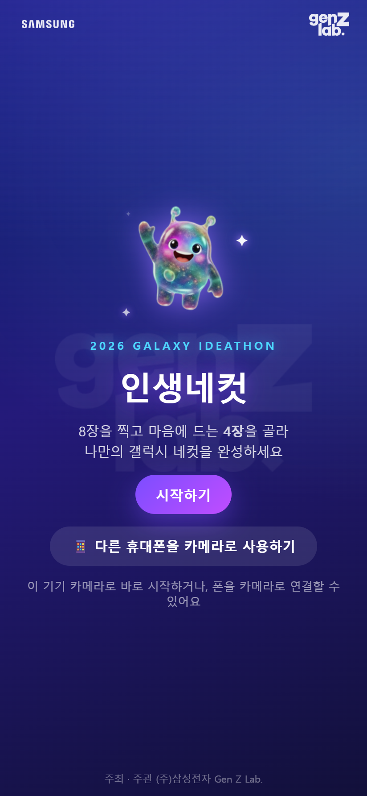
  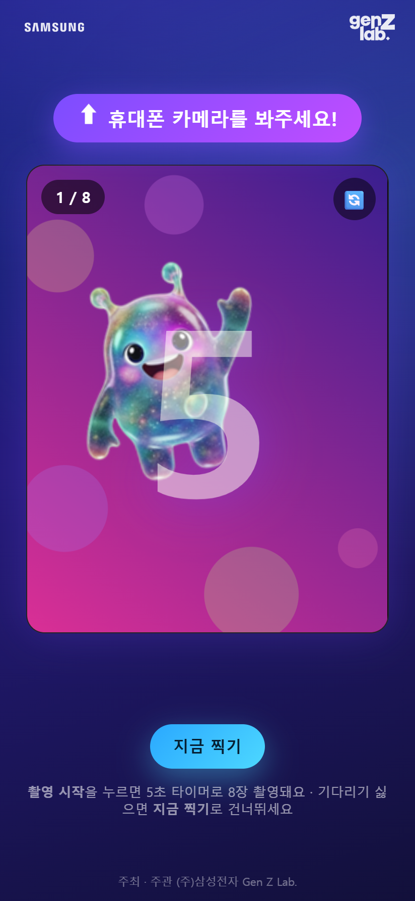
  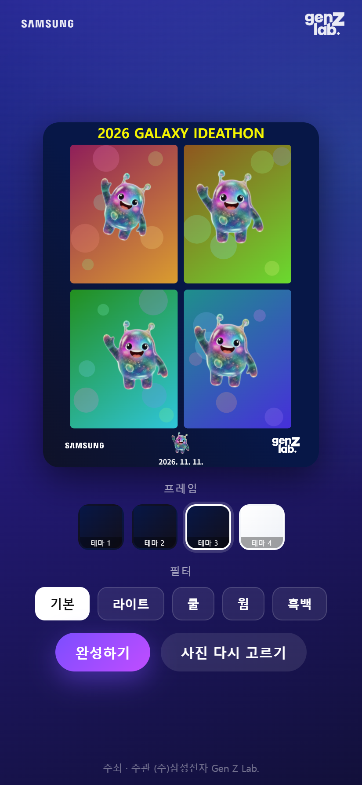
  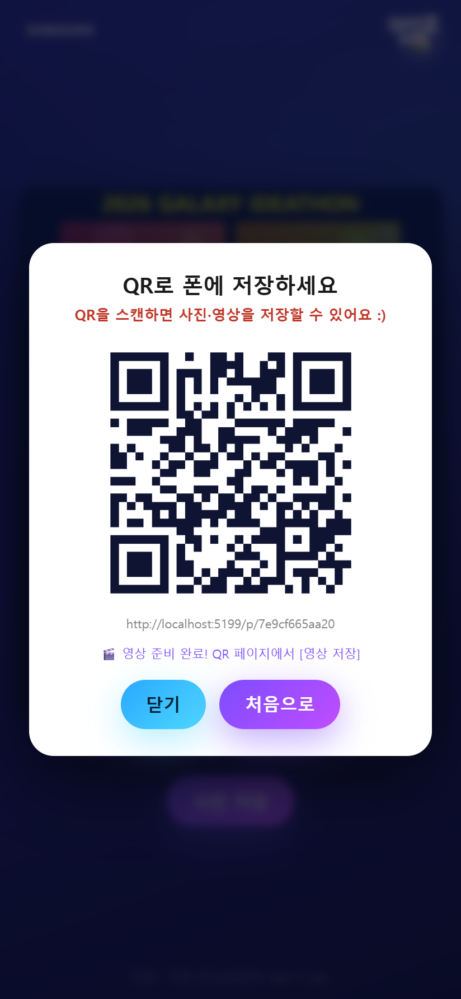
</p>

> 스크린샷은 실제 인물 대신 마스코트 **글리밍**이 나오는 데모용 카메라 화면으로 촬영했습니다.

---

## 주요 기능

| 구분 | 내용 |
|---|---|
| 촬영 | 8장 연속 촬영, 컷마다 5초 카운트다운, **지금 찍기**로 남은 시간 건너뛰기, 전/후면 전환, 셔터음·플래시 |
| 선택 | 8장 중 4장 선택(선택한 순서대로 배치), 🔍 확대해서 크게 보기 |
| 꾸미기 | 테마 4종 + 필터 5종(기본·라이트·쿨·웜·흑백), 오늘 날짜 자동 표기 |
| 전달 | 사진 저장 → QR 생성 → 손님 폰의 다운로드 페이지에서 **[사진] / [영상]** 저장 |
| 움직이는 4컷 | 카운트다운 동안의 실제 움직임을 녹화해 4컷이 동시에 움직이는 webm 영상으로 합성 |
| 폰 = 카메라 | 태블릿은 화면·조작, 폰은 카메라. QR로 페어링(WebRTC), 촬영 컷은 폰 원본 해상도로 전송 |
| 운영 | 누적 촬영 횟수를 서버 콘솔과 `count.json`에 기록, 2분 무동작 시 처음 화면으로 자동 복귀 |

## 사용 시나리오

전체 흐름을 화면별 스크린샷과 함께 정리한 문서: **[docs/SCENARIO.md](docs/SCENARIO.md)**

| 1. 시작 | 2. 촬영 | 3. 4장 선택 | 4. 테마·필터 |
|:-:|:-:|:-:|:-:|
|  | 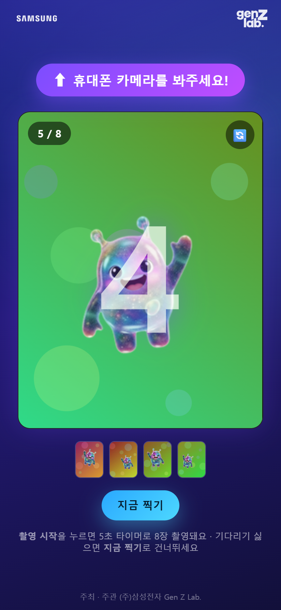 | 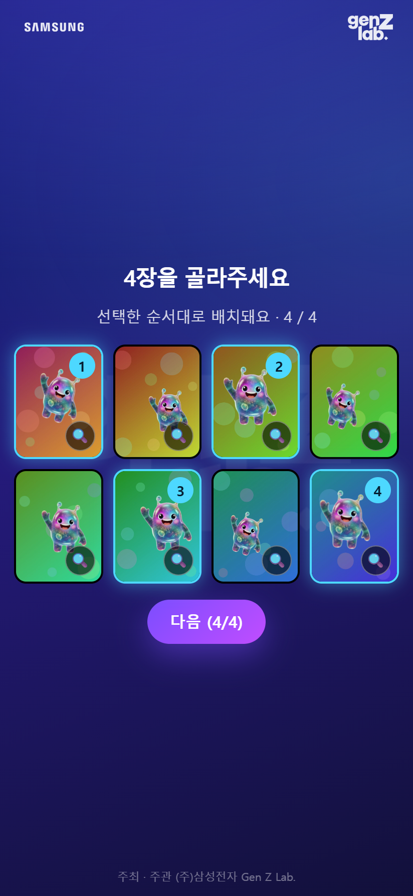 | 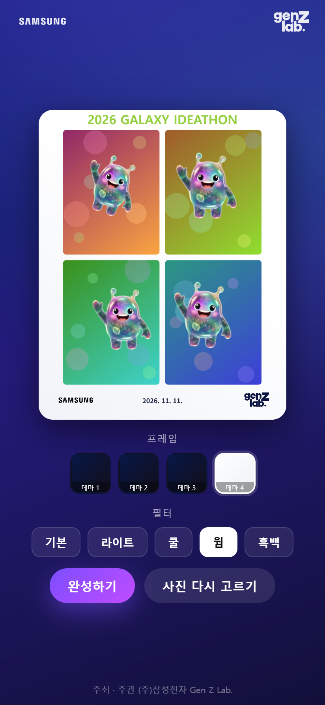 |

| 5. 완성 | 6. QR | 7. 폰에서 사진 저장 | 8. 폰에서 영상 저장 |
|:-:|:-:|:-:|:-:|
| 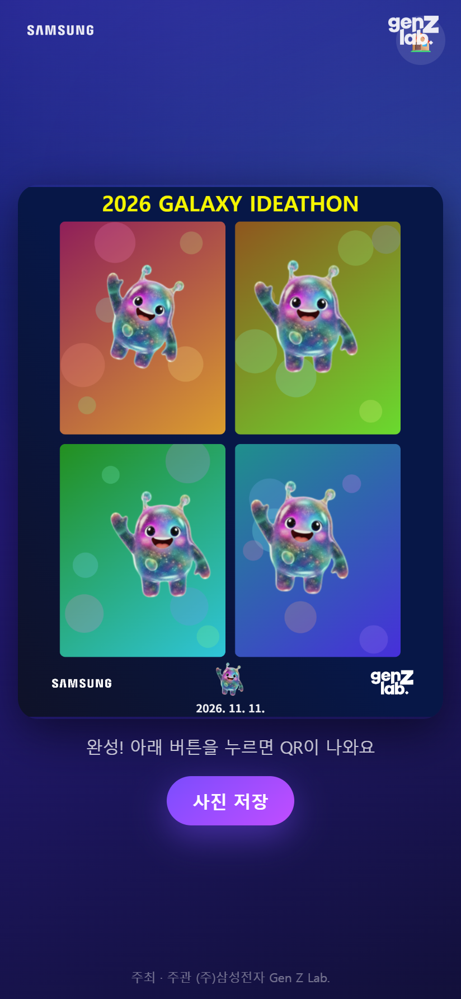 |  | 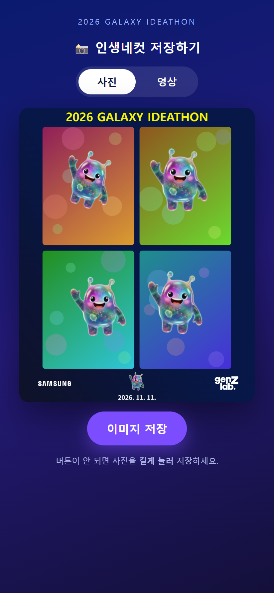 | 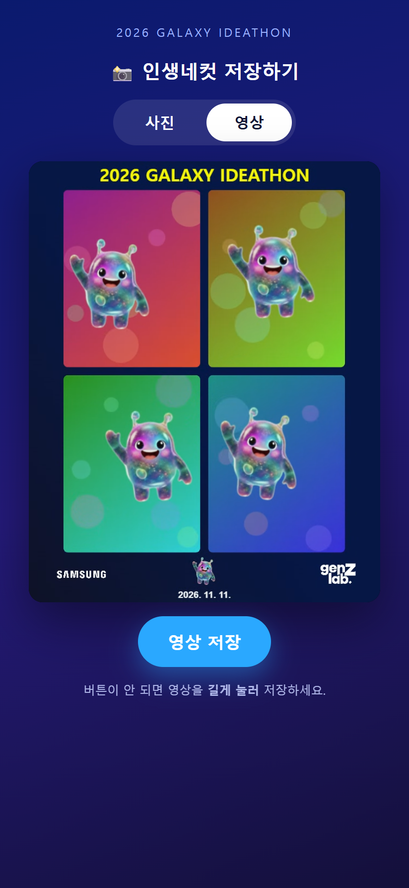 |

완성본 예시:

<p align="center">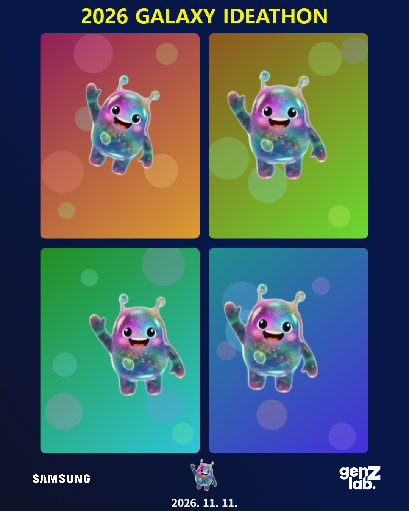</p>

---

## 빠른 시작

**준비물**: [Node.js](https://nodejs.org) 18 이상

```bash
git clone https://github.com/Ooohje/genz-lab-Photo-Booth.git
```

```bash
cd genz-lab-Photo-Booth
```

```bash
npm install
```

```bash
npm start
```

브라우저에서 `http://localhost:5173` 을 열면 바로 테스트할 수 있습니다.

### Windows에서 더블클릭으로 실행

`start-booth.bat` 을 더블클릭하면 다음을 한 번에 처리합니다.

1. 처음 실행이면 `npm install`
2. 5173 포트를 쓰고 있던 이전 서버 정리
3. Tailscale이 설치돼 있으면 `tailscale funnel` 로 공개 주소 열기
4. 서버 시작 (이 창을 닫으면 부스 종료)

### 태블릿·폰에서 쓰기 (HTTPS 필수)

카메라·QR·PWA는 브라우저 보안 정책상 **`https` 또는 `localhost`** 에서만 동작합니다. `http://192.168.x.x` 같은 주소로는 카메라가 열리지 않습니다.

1. [Tailscale](https://tailscale.com/download) 설치 후 로그인 (최초 1회, Funnel 활성화)
2. `start-booth.bat` 실행 → 콘솔의 `PUBLIC BOOTH URL` 에 표시된 `https://<기기명>.<tailnet>.ts.net` 확인
3. 갤럭시 탭 크롬에서 그 주소 열기 → **⋮ → 홈 화면에 추가** 하면 전체화면 앱으로 실행
4. 손님은 촬영 후 화면의 QR만 스캔하면 됩니다

수동으로 열려면 `tailscale funnel 5173`, 포트를 바꾸려면 `PORT=8080 node server.mjs` 로 실행합니다.

---

## 구조

```
├─ server.mjs           # Node 서버 (정적 서빙 + API + WebSocket 신호 중계)
├─ start-booth.bat      # Windows 런처 (포트 정리 + Tailscale Funnel + 서버 시작)
├─ _booth_msg.txt       # 런처가 출력하는 한글 안내문 (bat 인코딩 문제 회피)
├─ package.json         # 의존성: qrcode, ws
├─ DESIGN.md            # 초기 설계 문서
├─ docs/
│  ├─ SCENARIO.md       # 화면별 사용 시나리오
│  └─ screenshots/      # 스크린샷
└─ prototype/           # 부스 웹앱
   ├─ index.html        # 부스 앱 전체 (HTML/CSS/JS 단일 파일)
   ├─ cam.html          # 폰 = 카메라 페이지 (WebRTC 송출)
   ├─ frames.json       # 테마 정의
   ├─ manifest.json, sw.js   # PWA
   ├─ assets/           # 로고·마스코트
   └─ frames/           # 프레임용 이미지
```

실행 중 생기는 `uploads/`(업로드된 사진·영상)와 `count.json`(누적 촬영 횟수)은 저장소에 포함하지 않습니다.

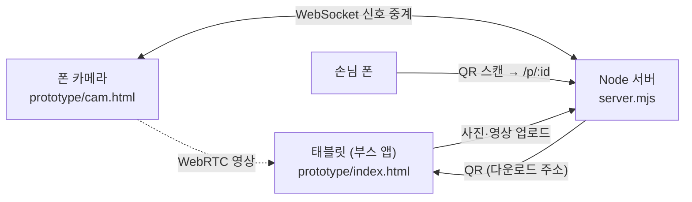

## 서버 API

| 메서드 | 경로 | 설명 |
|---|---|---|
| GET | `/` | 부스 앱 (`prototype/` 정적 서빙) |
| GET | `/cam?room=코드` | 폰 카메라 페이지 |
| POST | `/api/photos` | 합성 사진(JPEG) 업로드 → `{ id, url, qr, count }` |
| POST | `/api/videos?id=` | 영상(webm) 업로드, 사진 id에 연결 |
| GET | `/api/hasvideo?id=` | 영상 준비 여부 `{ ok }` |
| GET | `/api/qr?text=` | 임의 텍스트 QR (페어링용) |
| GET | `/p/:id` | 손님용 다운로드 페이지 (사진/영상 토글) |
| GET | `/i/:id.jpg`, `/v/:id` | 사진·영상 원본 |
| WS | (upgrade) | 폰 ↔ 태블릿 WebRTC 신호 중계 (room 단위) |

QR에 들어가는 주소는 요청의 `x-forwarded-*` 헤더로 계산하므로, Funnel 같은 프록시 뒤에서도 공개 주소로 생성됩니다.

## 커스터마이징

- **테마 추가·수정** — `prototype/frames.json` 의 `frames` 배열에 항목만 추가하면 됩니다. 배경 그라디언트, 헤더 문구·색, 하단 로고 배치(`bottom`), 날짜 위치(`datePos`)를 테마별로 지정할 수 있고 합성 코드는 건드릴 필요가 없습니다.
- **카운트다운·촬영 장수** — `prototype/index.html` 의 `COUNTDOWN_SECONDS`, `SHOTS`, `PICKS`
- **필터** — 같은 파일의 `FILTERS` 배열 (CSS filter 문자열)
- **영상 품질** — `REC_FPS`(초당 프레임), `REC_MAX`(컷당 최대 프레임)

## 운영 팁

- `server.mjs` 를 수정했으면 서버를 재시작해야 합니다. 화면 파일(`prototype/`)만 고쳤으면 새로고침으로 충분합니다.
- 폰에서 화면이 데스크톱 비율로 보이면 크롬의 **데스크톱 사이트** 옵션을 끄세요.
- 폰 = 카메라 모드는 폰과 태블릿이 **같은 Wi-Fi** 에 있을 때 가장 잘 연결됩니다(TURN 서버 없음). 폰 화면은 켜 둔 채로 거치하세요.
- 업로드된 파일은 자동 삭제되지 않습니다. 행사가 끝나면 `uploads/` 를 직접 정리하세요.
- 누적 촬영 횟수를 초기화하려면 서버를 끄고 `count.json` 을 `{"count":0,"saves":[]}` 로 바꿉니다.
- 서버에는 인증이 없습니다. 공개 주소는 행사 중에만 열어 두고, 끝나면 Funnel을 끄세요.

## 문제 해결

| 증상 | 확인할 것 |
|---|---|
| 카메라가 안 뜸 | 주소가 `https` 또는 `localhost` 인지, 카메라 권한을 허용했는지 |
| QR을 찍어도 안 열림 | 태블릿을 `localhost` 가 아닌 공개 `https` 주소로 열었는지 (QR은 접속한 주소 기준으로 생성됨) |
| 영상 탭이 계속 준비 중 | 서버를 최신 `server.mjs` 로 재시작했는지, 브라우저가 MediaRecorder(webm)를 지원하는지 |
| 폰 카메라가 연결 안 됨 | 폰과 태블릿이 같은 Wi-Fi 인지, 폰 화면이 꺼지지 않았는지 |

---

주최 · 주관 (주)삼성전자 Gen Z Lab.
