# 사용 시나리오

부스를 켜는 순간부터 손님이 자기 폰에 사진·영상을 저장할 때까지의 흐름입니다.
스크린샷은 실제 인물 대신 마스코트 **글리밍**이 나오는 데모용 카메라 화면으로 촬영했습니다.

- [A. 기본 시나리오 — 이 기기 카메라로 촬영](#a-기본-시나리오--이-기기-카메라로-촬영)
- [B. 손님 폰 — QR로 저장](#b-손님-폰--qr로-저장)
- [C. 폰 = 카메라 시나리오 — 태블릿은 화면, 폰은 카메라](#c-폰--카메라-시나리오--태블릿은-화면-폰은-카메라)
- [D. 운영자 시나리오](#d-운영자-시나리오)

---

## A. 기본 시나리오 — 이 기기 카메라로 촬영

### 1. 인트로 → 홈

앱을 열면 글리밍 스플래시가 잠깐 보인 뒤 홈 화면으로 넘어갑니다.
**시작하기**를 누르면 전체화면으로 전환되고 카메라가 켜집니다.

| 스플래시 | 홈 |
|:-:|:-:|
| 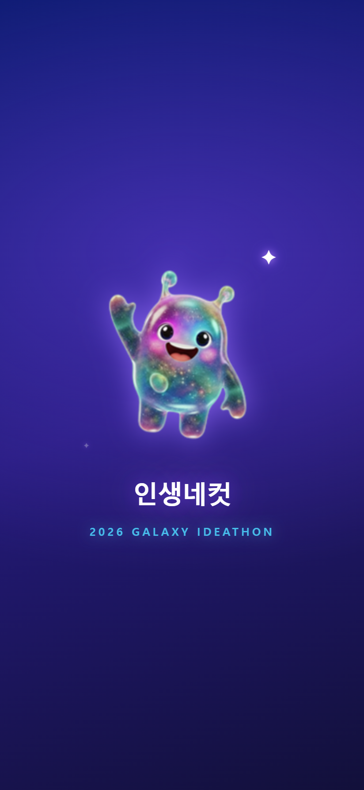 | 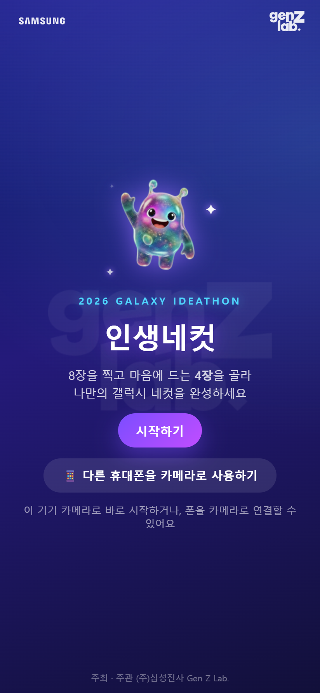 |

### 2. 촬영 (8장)

- 미리보기는 실제 사진 한 칸과 같은 비율(31:40)이라 **보이는 대로 찍힙니다.**
- 미리보기는 거울처럼 좌우 반전되지만, 저장되는 사진은 원래 방향입니다.
- **촬영 시작**을 누르면 컷마다 5초 카운트다운 후 자동 촬영됩니다.
- 기다리기 싫으면 **지금 찍기**로 남은 시간을 건너뜁니다.
- 찍은 컷은 아래 썸네일 줄에 차례로 쌓입니다. 우측 상단 🔄 로 전/후면 카메라를 바꿀 수 있습니다.

| 촬영 대기 | 카운트다운 | 촬영 진행 중 |
|:-:|:-:|:-:|
| 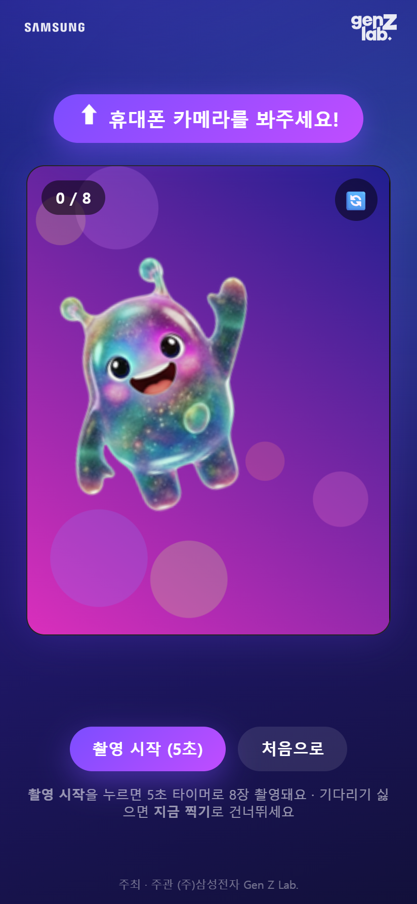 | 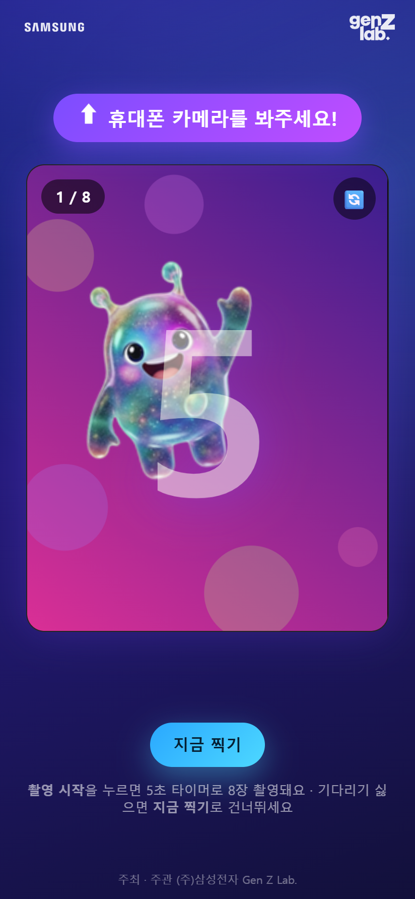 | 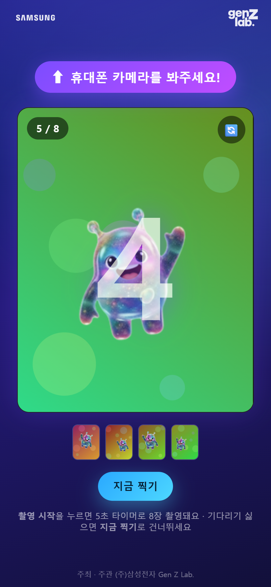 |

> 카운트다운을 기다리는 동안의 움직임은 따로 녹화되어, 나중에 **움직이는 4컷 영상**이 됩니다.

### 3. 4장 선택

8장 중 마음에 드는 4장을 탭합니다. **선택한 순서대로** 좌상 → 우상 → 좌하 → 우하에 배치됩니다.
사진 오른쪽 아래 🔍 를 누르면 선택과 상관없이 크게 볼 수 있습니다.

| 선택 전 | 4장 선택 | 확대 보기 |
|:-:|:-:|:-:|
| 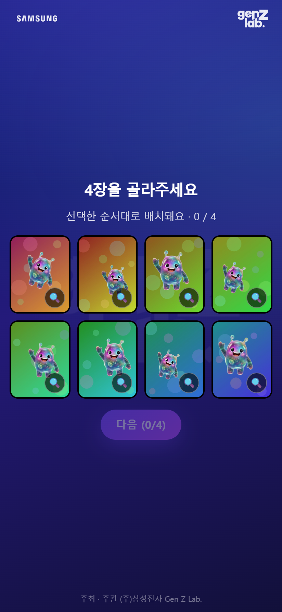 | 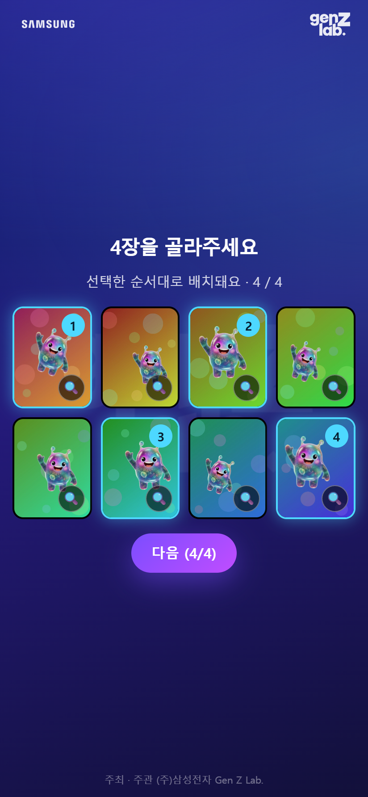 | 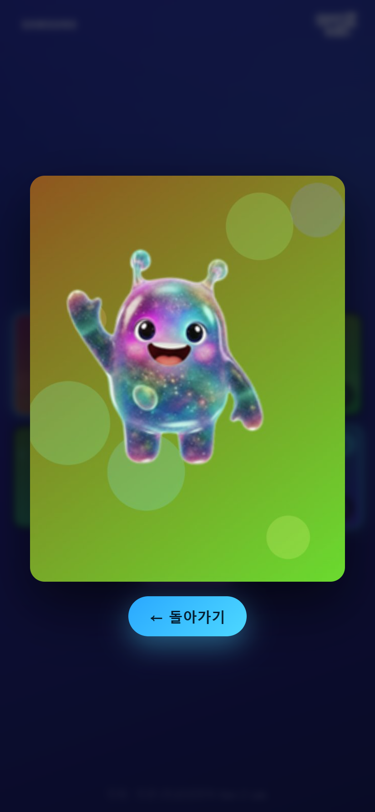 |

### 4. 테마 · 필터

테마 4종과 필터 5종(기본·라이트·쿨·웜·흑백)을 고르면 미리보기에 바로 반영됩니다.
날짜는 오늘 날짜가 자동으로 들어갑니다. **사진 다시 고르기**로 선택 화면에 돌아갈 수 있습니다.

| 테마 1 · 기본 | 테마 4 · 웜 | 테마 3 · 기본 |
|:-:|:-:|:-:|
| 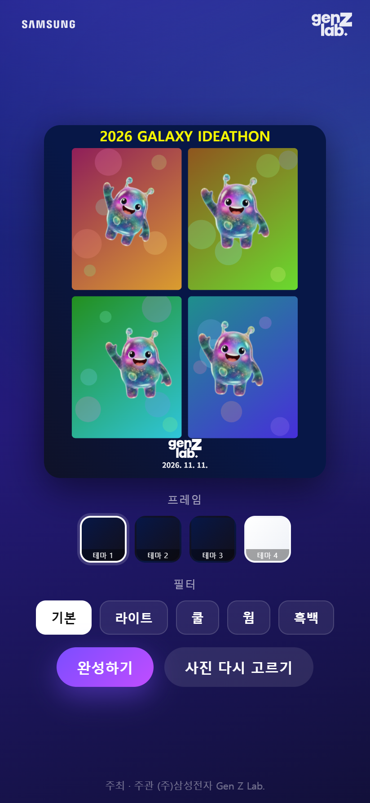 | 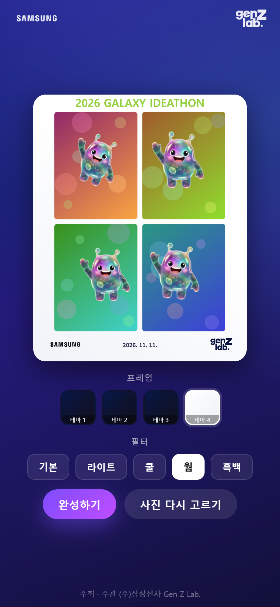 | 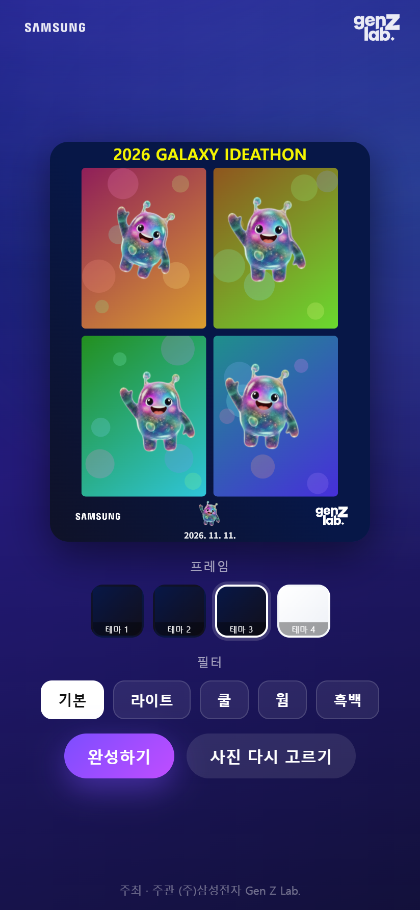 |

### 5. 완성 → QR

**완성하기** → **사진 저장**을 누르면 사진이 서버에 올라가고 QR이 뜹니다.
영상은 뒤에서 따로 만들어지므로 QR은 기다림 없이 바로 나옵니다. 준비가 끝나면 안내 문구가 "영상 준비 완료"로 바뀝니다.

| 완성 | QR |
|:-:|:-:|
| 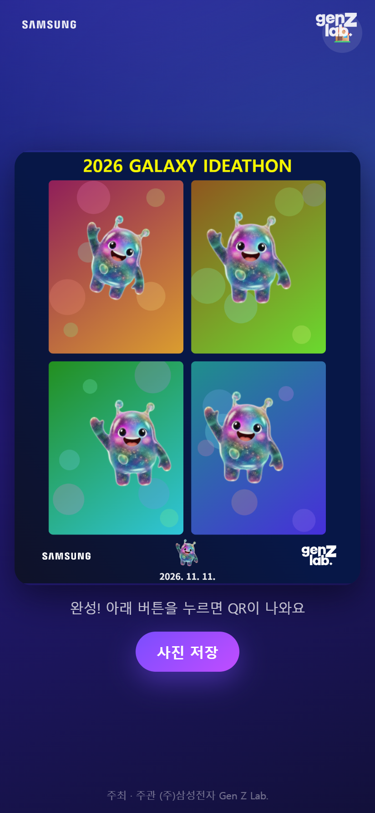 | 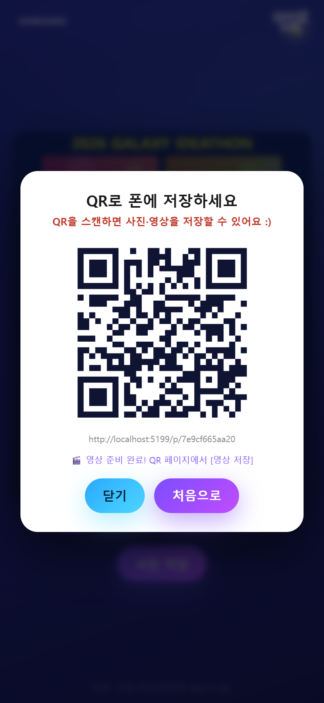 |

**처음으로**를 누르면 다음 손님을 위해 홈으로 돌아갑니다. 2분 동안 아무 조작이 없어도 자동으로 홈으로 돌아갑니다.

---

## B. 손님 폰 — QR로 저장

손님은 앱 설치나 링크 입력 없이 QR만 스캔합니다. 다운로드 페이지에서 **[사진] / [영상]** 을 전환해 각각 저장합니다.
버튼이 동작하지 않는 브라우저에서는 사진·영상을 길게 눌러 저장할 수 있습니다.

| 사진 탭 | 영상 탭 |
|:-:|:-:|
| 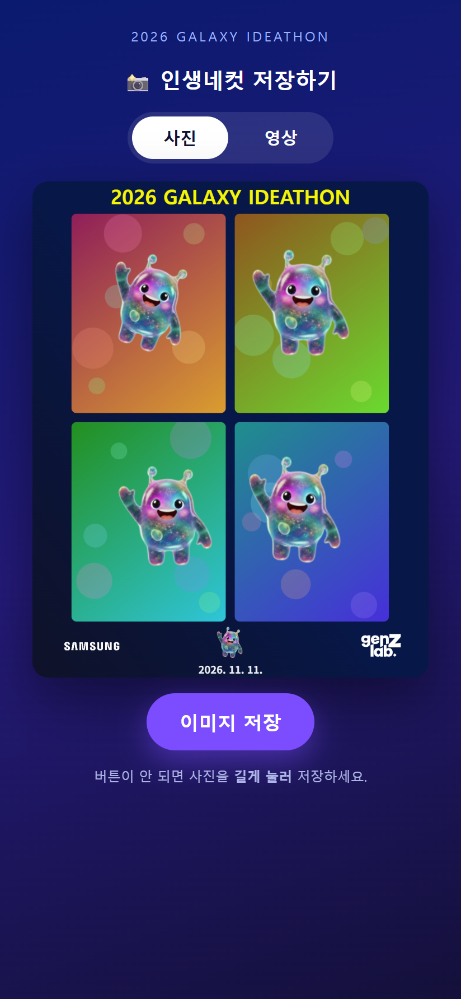 | 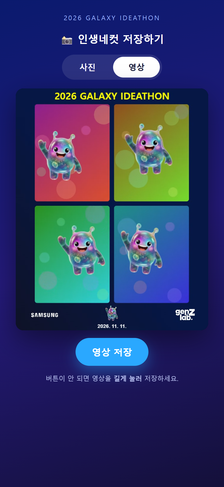 |

영상은 4컷이 동시에 움직이는 짧은 반복 영상(webm)입니다. 아직 만들어지는 중이면 영상 탭에 "준비 중" 표시가 나오고, 준비되면 자동으로 나타납니다.

완성본 예시:

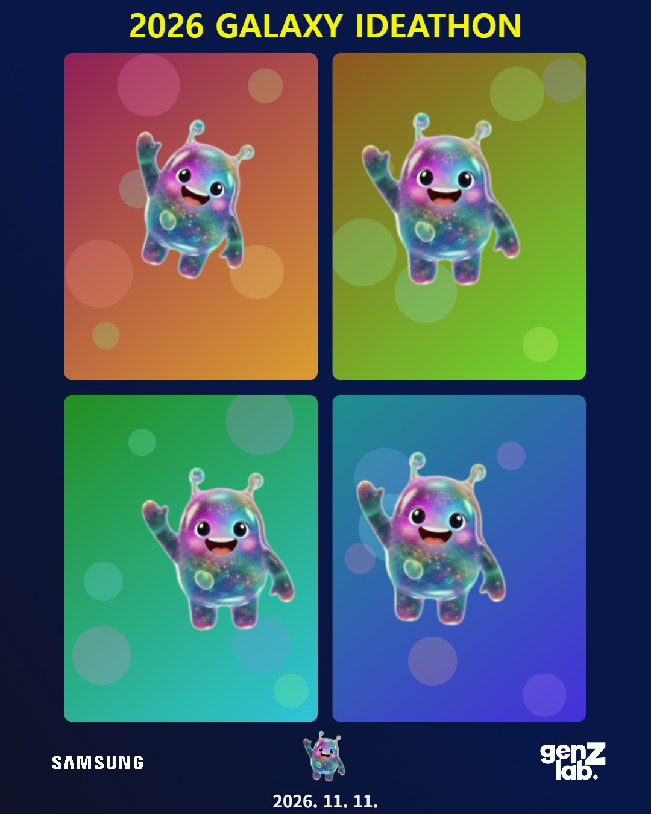

---

## C. 폰 = 카메라 시나리오 — 태블릿은 화면, 폰은 카메라

태블릿 카메라 대신 화질 좋은 폰 카메라로 찍고, 큰 화면(태블릿)으로 미리보기와 조작을 하는 방식입니다.

### 1. 태블릿에서 페어링 QR 띄우기

홈에서 **📱 다른 휴대폰을 카메라로 사용하기**를 누르면 페어링용 QR이 뜹니다.

| 태블릿 홈 | 페어링 QR |
|:-:|:-:|
| 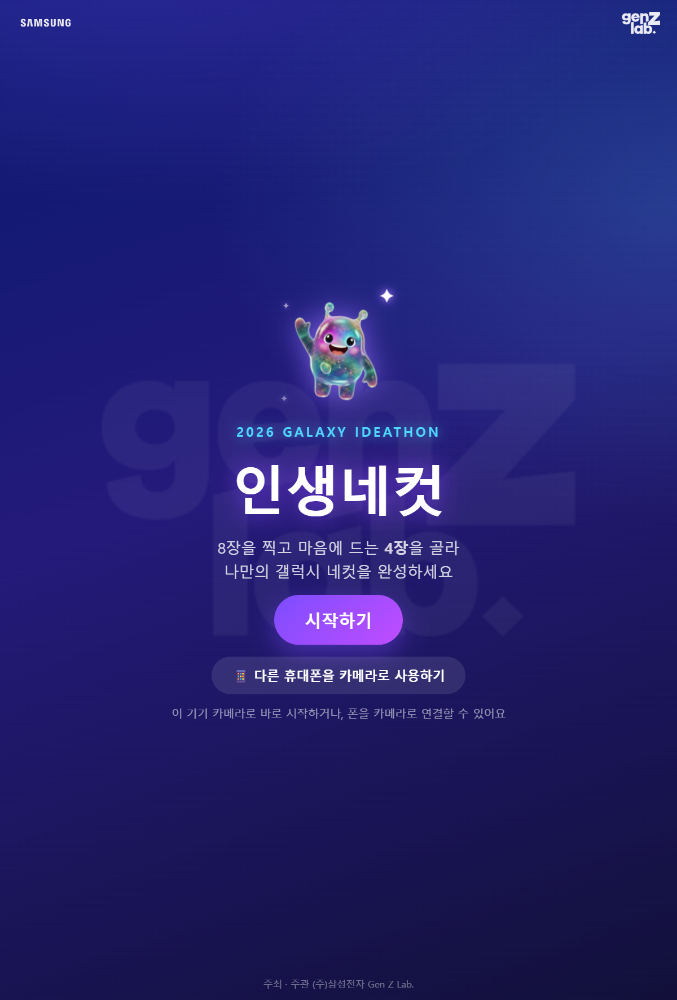 | 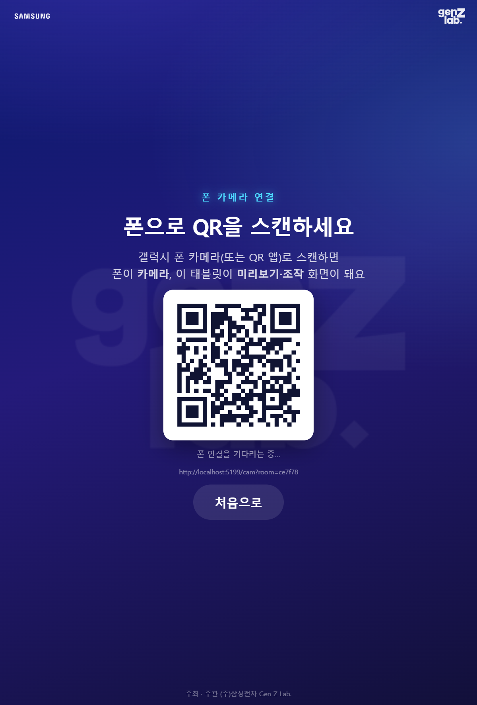 |

### 2. 폰으로 QR 스캔

폰에서 카메라 페이지가 열리고 권한을 허용하면 태블릿과 자동으로 연결됩니다. 연결되면 배지가 **LIVE** 로 바뀝니다.
폰은 화면을 켠 채로 거치해 둡니다.

### 3. 태블릿에서 촬영 진행

연결되는 순간 태블릿이 촬영 화면으로 넘어가고 폰 카메라 영상이 실시간으로 보입니다.
이후 촬영·선택·편집·저장은 A 시나리오와 똑같이 태블릿에서 진행합니다. 촬영 컷은 폰이 원본 해상도로 직접 찍어 보내므로 미리보기보다 선명합니다.

| 폰 (카메라) | 태블릿 (미리보기·조작) |
|:-:|:-:|
| 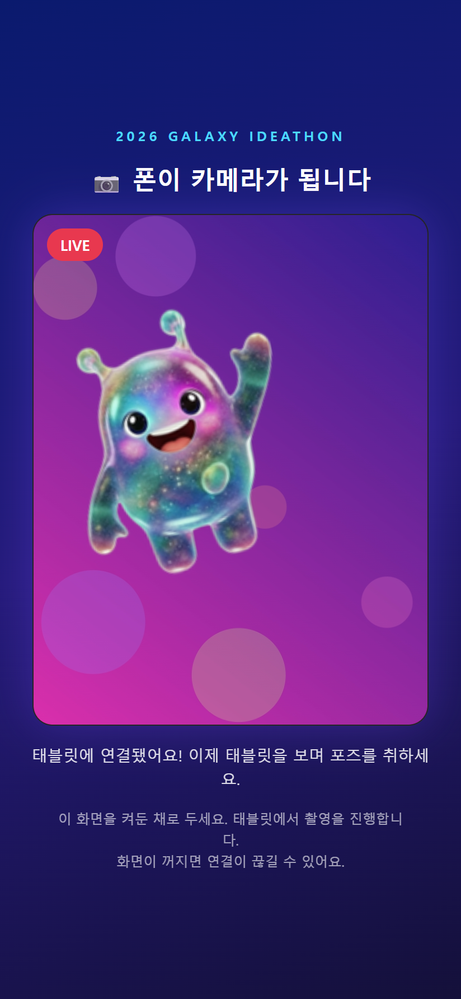 | 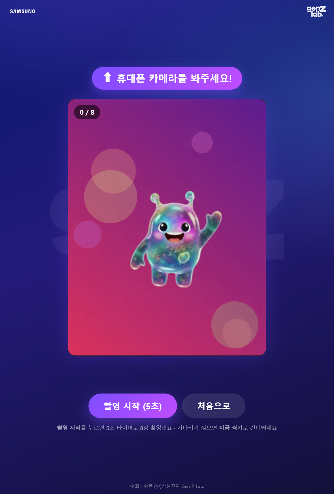 |

폰 연결은 홈으로 돌아가도 유지되므로 손님이 바뀔 때마다 다시 스캔할 필요가 없습니다. 해제하려면 홈의 **📱 폰 연결됨 ✓ · 해제하려면 탭** 버튼을 누릅니다.

---

## D. 운영자 시나리오

| 시점 | 할 일 |
|---|---|
| 행사 전 (최초 1회) | PC에 Node.js·Tailscale 설치 및 로그인, Funnel 활성화 |
| 부스 열기 | `start-booth.bat` 더블클릭 → 콘솔의 `PUBLIC BOOTH URL` 을 태블릿 크롬에서 열기 → 홈 화면에 추가 |
| (선택) 폰 카메라 | 태블릿 홈에서 페어링 QR을 띄우고 폰으로 스캔, 폰 거치 |
| 운영 중 | 서버 콘솔에 `>> N번째 촬영 저장됨 (시각)` 이 찍히는지 확인. 서버 창은 닫지 않기 |
| 부스 닫기 | 서버 창 닫기, Funnel 끄기 |
| 행사 후 | `uploads/` 의 사진·영상 정리, 필요하면 `count.json` 초기화 |

막히는 부분이 있으면 [README의 문제 해결](../README.md#문제-해결)을 참고하세요.
